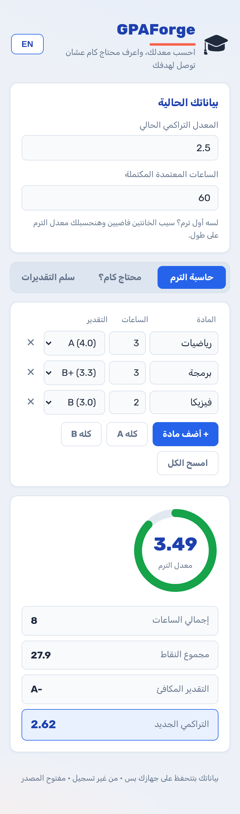
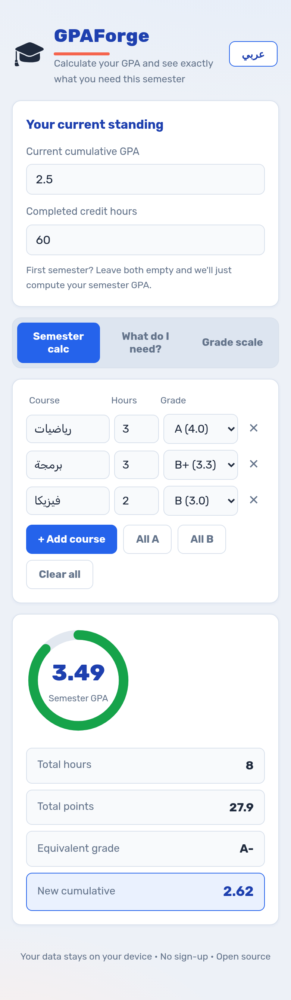
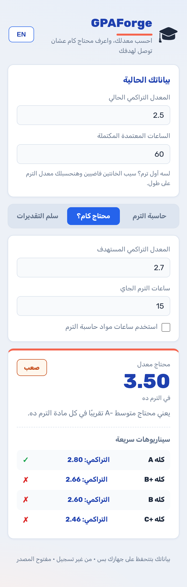
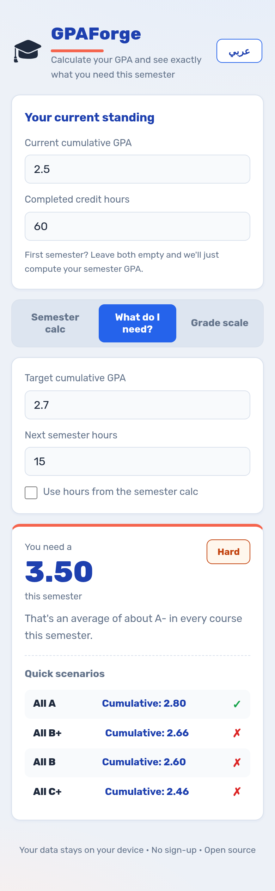
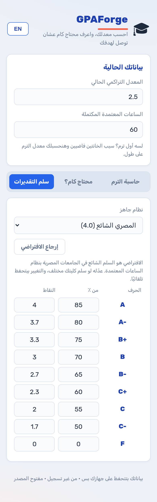

# GPAForge 🎓

**Live:** https://mostaaafaomran-ctrl.github.io/gpaforge/

A GPA planner for Egyptian university students (credit-hour system). Calculate your semester GPA, project your new cumulative GPA, and answer the real question: **"what grades do I need this semester to reach my target?"** — no sign-up, no server, your data stays on your device.

مخطط معدل تراكمي لطلبة الجامعات المصرية بنظام الساعات المعتمدة: احسب معدل الترم، واعرف التراكمي الجديد، والأهم — **محتاج تجيب كام الترم ده عشان توصل لهدفك**. من غير تسجيل ولا سيرفر، وبياناتك بتفضل على جهازك.

## Screenshots · صور

| Arabic · عربي | English |
| --- | --- |
|  |  |
|  |  |



## Features · المميزات

- **Semester calculator** — courses with credit hours and grades, live semester GPA with a progress ring, total points, equivalent letter grade, and your projected new cumulative GPA.
- **حاسبة الترم** — مواد بالساعات والتقديرات، معدل الترم لحظة بلحظة مع دايرة تقدم، مجموع النقاط، التقدير المكافئ، والتراكمي الجديد المتوقع.
- **"What do I need?" planner** — enter your target cumulative GPA and this semester's hours; get the exact semester GPA required, a feasibility badge (from *guaranteed* to *impossible this semester*), the average letter you need, and quick scenarios (all A, all B+, ...).
- **تبويب "محتاج كام؟"** — حط المعدل المستهدف وساعات الترم، ويعرفك محتاج معدل كام بالظبط، مع تقييم للصعوبة (من "مضمون" لـ"مستحيل الترم ده")، متوسط التقدير المطلوب، وسيناريوهات جاهزة.
- **Editable grade scale** — the common Egyptian credit-hour scale by default (A = 4.0 from 85%), plus a simple US preset; adjust thresholds and points to match your faculty.
- **سلم تقديرات قابل للتعديل** — السلم المصري الشائع افتراضيًا، مع نظام أمريكي بسيط، وتقدر تظبطه على سلم كليتك.
- **Arabic-first UI with full RTL**, one-tap English toggle. **واجهة عربية كاملة مع زرار إنجليزي.**
- **Private by design** — everything is saved in your browser's localStorage only. **خصوصية كاملة** — كل حاجة بتتحفظ في متصفحك بس.

## Run locally · التشغيل محليًا

It's plain HTML/CSS/JS with no build step:

```bash
git clone https://github.com/mostaaafaomran-ctrl/gpaforge.git
cd gpaforge
# open index.html directly, or serve it:
python3 -m http.server 8000
```

ملفات HTML وCSS وJS عادية من غير أي خطوة بناء — افتح `index.html` على طول أو شغّل سيرفر محلي زي اللي فوق.

## Tech · التقنيات

Vanilla HTML, CSS and JavaScript. Rubik font via Google Fonts. Deployed on GitHub Pages.

HTML وCSS وJavaScript خالص، خط Rubik من Google Fonts، ومنشور على GitHub Pages.

## License · الرخصة

MIT — see [LICENSE](LICENSE). رخصة MIT — شوف ملف [LICENSE](LICENSE).
